# 📚 DOKUMENTASI ARSITEKTUR & KOMPONEN WEB
## *E-Art Gallery of Emergency*
> **Panduan Teknis untuk Penulisan Skripsi (Bab III: Perancangan Sistem & Bab IV: Implementasi dan Pengujian)**

---

## DAFTAR ISI
1. [Pendahuluan & Konsep Arsitektur Komponen](#1-pendahuluan--konsep-arsitektur-komponen)
2. [Diagram Hierarki & Pohon Komponen (Component Tree)](#2-diagram-hierarki--pohon-komponen-component-tree)
3. [Daftar & Penjelasan Lengkap Komponen Berdasarkan Kategori](#3-daftar--penjelasan-lengkap-komponen-berdasarkan-kategori)
   - [3.1 Komponen Halaman Utama (Page & Route Components)](#31-komponen-halaman-utama-page--route-components)
   - [3.2 Komponen Tata Letak Global (Layout Components)](#32-komponen-tata-letak-global-layout-components)
   - [3.3 Komponen Seksi Beranda (Landing Page Section Components)](#33-komponen-seksi-beranda-landing-page-section-components)
   - [3.4 Komponen Edukasi Anatomi & Ilustrasi Interaktif](#34-komponen-edukasi-anatomi--ilustrasi-interaktif)
   - [3.5 Komponen Animasi & Kinerja Halus (Motion Components)](#35-komponen-animasi--kinerja-halus-motion-components)
   - [3.6 Komponen UI & Ornamen Budaya (UI & Cultural Elements)](#36-komponen-ui--ornamen-budaya-ui--cultural-elements)
4. [Tabel Spesifikasi Teknis Komponen (Props, State, & Hooks)](#4-tabel-spesifikasi-teknis-komponen-props-state--hooks)
5. [Desain Sistem, Filosofi Warna, & Integrasi Budaya Batik](#5-desain-sistem-filosofi-warna--integrasi-budaya-batik)
6. [Panduan Penulisan Skripsi (Rekomendasi Penempatan Bab)](#6-panduan-penulisan-skripsi-rekomendasi-penempatan-bab)

---

## 1. PENDAHULUAN & KONSEP ARSITEKTUR KOMPONEN

Aplikasi web **E-Art Gallery of Emergency** dirancang dengan pendekatan **Component-Based Architecture (CBA)** menggunakan framework **Next.js 16 (App Router)** dan library **React 19**.

### Prinsip Perancangan Perangkat Lunak:
1. **Separation of Concerns (SoC)**: Pemisahan tegas antara logika data (`data/`), logika presentasi visual (`components/`), interaktivitas animasi (`components/animations/`), dan routing halaman (`app/`).
2. **Reusability & Modularity**: Komponen didekomposisi menjadi unit-unit independen yang dapat digunakan kembali di berbagai halaman (contoh: `SectionHeading`, `BatikOrnament`, `MedicalIllustration`).
3. **Hybrid Rendering Strategy**:
   - **Server Components (RSC)**: Digunakan untuk pre-rendering halaman publik berkecepatan tinggi, SEO teroptimasi, dan pengiriman nol *client bundle* untuk konten statis.
   - **Client Components (`"use client"`)**: Diterapkan secara selektif pada komponen yang membutuhkan interaktivitas dinamis (seleksi tab, pengujian kuis interaktif, manipulasi DOM GSAP/Lenis, dan render SVG berbasis waktu).
4. **Cultural Ergonomics & Interactive Media**: Memadukan teori komunikasi visual medis yang ramah (menghindari visual gore kecelakaan yang memicu trauma) dengan ornamen estetika batik nusantara untuk menumbuhkan nilai luhur gotong royong bagi mitra pengemudi ojek online.

---

## 2. DIAGRAM HIERARKI & POHON KOMPONEN (COMPONENT TREE)

Berikut adalah struktur hubungan hierarkis antar-komponen di dalam aplikasi:

```mermaid
graph TD
    Root[RootLayout: app/layout.tsx] --> AppBody[Global Providers & CSS Canvas]
    
    %% Routing Pages
    AppBody --> P_HOME["Home Page: app/page.tsx"]
    AppBody --> P_MATERI["Katalog Materi: app/materi/page.tsx"]
    AppBody --> P_DETAIL["Detail Materi: app/materi/[slug]/page.tsx"]
    AppBody --> P_LKPD["Kasus LKPD: app/lkpd/page.tsx"]
    AppBody --> P_EVAL["Evaluasi Kuis: app/evaluasi/page.tsx"]
    AppBody --> P_ABOUT["Tentang Kami: app/tentang/page.tsx"]

    %% Wrap SmoothScroll
    P_HOME --> SS[SmoothScroll Provider: Lenis + GSAP Ticker]
    
    %% Shared Layout Components
    SS --> NAV[Navbar]
    SS --> FOOT[Footer]
    SS --> BTT[BackToTop]

    %% Sections di Landing Page
    SS --> SEC1[HeroSection]
    SS --> SEC2[FeaturedArtwork]
    SS --> SEC3[CategorySection]
    SS --> SEC4[CapaianPembelajaran]
    SS --> SEC5[LearningTimeline]
    SS --> SEC6[LearningObjectives]
    SS --> SEC7[MaterialSection]
    SS --> SEC8[LkpdPreviewSection]
    SS --> SEC9[EvaluasiPreviewSection]
    SS --> SEC10[CallToAction]

    %% Sub-komponen Interaktif
    SEC1 --> B_ORN[BatikOrnament: ribbon/corner]
    SEC1 --> L_LOOP[LogoLoop: Marquee Motif Batik]
    
    SEC2 --> SH1[SectionHeading]
    SEC2 --> SR1[ScrollReveal / StaggerReveal]
    SEC2 --> MI1[MedicalIllustration]
    
    SEC5 --> GSAP_TL[GSAP Timeline Animation]
    
    %% Materi Detail Illustrations
    P_DETAIL --> BTI[BleedingTypesIllustration]
    P_DETAIL --> FTI[FractureTypesIllustration]
    
    BTI --> BVI[BloodVesselIllustration: Arteri / Vena / Kapiler SVG]
    FTI --> FI[FractureIllustration: Tertutup vs Terbuka SVG]
```

---

## 3. DAFTAR & PENJELASAN LENGKAP KOMPONEN BERDASARKAN KATEGORI

### 3.1 Komponen Halaman Utama (Page & Route Components)

| Nama Berkas | Rute URL | Tipe Rendering | Fungsi & Peran dalam Sistem |
|---|---|---|---|
| [`app/layout.tsx`](file:///d:/emergency-uhuy/app/layout.tsx) | *Root* | Server Component | Berfungsi sebagai pembungkus utama (*master template*). Mengatur konfigurasi font Google (`Plus Jakarta Sans` dan `Caveat`), metadata SEO, favicon SVG, serta struktur `<html>` dan `<body>`. |
| [`app/page.tsx`](file:///d:/emergency-uhuy/app/page.tsx) | `/` | Server Component | Halaman beranda (*landing page*). Mengorkestrasi 10 seksi pembelajaran serta menyematkan layer kanvas latar belakang motif batik halus Nusantara secara fixed. |
| [`app/materi/page.tsx`](file:///d:/emergency-uhuy/app/materi/page.tsx) | `/materi` | Server Component | Katalog edukasi yang menampilkan 3 modul inti kedaruratan (Perdarahan, Pingsan, Fraktur) beserta nomor darurat bebas pulsa nasional 112/119. |
| [`app/materi/[slug]/page.tsx`](file:///d:/emergency-uhuy/app/materi/[slug]/page.tsx) | `/materi/:slug` | Dynamic SSG/ISR | Halaman modul kedaruratan mendalam. Menghadirkan daftar isi (*sticky sidebar*), panduan langkah demi langkah, tindakan yang harus dihindari, dan komponen ilustrasi interaktif sesuai slug kasus. |
| [`app/lkpd/page.tsx`](file:///d:/emergency-uhuy/app/lkpd/page.tsx) | `/lkpd` | Client Component | Lembar Kerja Peserta Didik (LKPD). Menyajikan 3 skenario insiden jalanan nyata dengan formulir interaktif untuk melatih daya nalar mitigasi driver di lapangan. |
| [`app/evaluasi/page.tsx`](file:///d:/emergency-uhuy/app/evaluasi/page.tsx) | `/evaluasi` | Client Component | Mesin evaluasi kesiapsiagaan darurat. Menyediakan 5 soal pilihan ganda berbatas waktu dengan kalkulasi skor otomatis, analisis benar/salah, dan pembahasan medis mendalam. |
| [`app/tentang/page.tsx`](file:///d:/emergency-uhuy/app/tentang/page.tsx) | `/tentang` | Server Component | Dokumentasi filosofi perancangan *E-Art Gallery of Emergency*, tim perancang, metodologi edukasi visual, dan palet warna desain sistem. |

---

### 3.2 Komponen Tata Letak Global (Layout Components)

#### 1. `Navbar` ([`components/layout/Navbar.tsx`](file:///d:/emergency-uhuy/components/layout/Navbar.tsx))
* **Peran**: Navigasi global yang melayang (*sticky header*).
* **Fitur Kunci**:
  * Efek *scroll detection*: Berubah dari transparan ke latar *white glassmorphism* (`backdrop-blur-xl`) ketika halaman digulir > 15px.
  * *Mobile Navigation Drawer*: Memiliki menu hamburger interaktif dengan animasi transisi dan penguncian scroll layar (`overflow-hidden`) saat dibuka.
  * Indikator rute aktif: Menyoroti tab yang sedang diakses secara otomatis.

#### 2. `Footer` ([`components/layout/Footer.tsx`](file:///d:/emergency-uhuy/components/layout/Footer.tsx))
* **Peran**: Kaki halaman penutup yang memuat hak cipta, peta situs cepat, peringatan hukum/disclaimer medis, serta tombol aksi cepat panggilan darurat 112/119.

---

### 3.3 Komponen Seksi Beranda (Landing Page Section Components)

#### 1. `HeroSection` ([`components/sections/HeroSection.tsx`](file:///d:/emergency-uhuy/components/sections/HeroSection.tsx))
* **Peran**: Seksi pertama (*above-the-fold*) untuk menarik perhatian mitra driver.
* **Fitur Kunci**:
  * Animasi *staggered timeline* GSAP untuk teks tajuk dan ilustrasi driver ojol.
  * Latar belakang tekstur motif batik sogan klasik dengan gradasi *vignette* hangat.
  * Ornamen sudut vektor batik tradisional dan halo lingkaran pada ilustrasi.
  * Karusel berjalan tak terhingga (*infinite marquee*) menampilkan ragam motif batik Nusantara.

#### 2. `AboutVideoSection` ([`components/sections/AboutVideoSection.tsx`](file:///d:/emergency-uhuy/components/sections/AboutVideoSection.tsx))
* **Peran**: Seksi pengantar inisiatif dan profil pengembang (*About Me*) yang terletak persis di bawah HeroSection.
* **Fitur Kunci**:
  * Pemutar video interaktif dengan bingkai peramban modern (*media player window*) dan tombol putar berefek gelombang getar (*pulse ripple*).
  * Menampilkan video simulasi respons darurat/pengantar media edukasi.
  * Deskripsi narasi *About Me*, urgensi peran ojol sebagai *first responder*, 3 pilar nilai inti, serta tombol navigasi menuju katalog materi dan halaman detail.

#### 3. `FeaturedArtwork` ([`components/sections/FeaturedArtwork.tsx`](file:///d:/emergency-uhuy/components/sections/FeaturedArtwork.tsx))
* **Peran**: Galeri kartu seni medis pilihan (*Perdarahan*, *Pingsan*, *Fraktur*). Memanfaatkan efek *hover micro-interaction* untuk mendorong eksplorasi.

#### 4. `CategorySection` ([`components/sections/CategorySection.tsx`](file:///d:/emergency-uhuy/components/sections/CategorySection.tsx))
* **Peran**: Menu taksonomi 6 pilar galeri (Tarahu, Capaian Pembelajaran, Alur Pembelajaran, Materi Driver, LKPD Driver, dan Evaluasi Kesiapsiagaan).

#### 5. `CapaianPembelajaran` ([`components/sections/CapaianPembelajaran.tsx`](file:///d:/emergency-uhuy/components/sections/CapaianPembelajaran.tsx))
* **Peran**: Menjabarkan Capaian Pembelajaran (CP) dan target kompetensi kedaruratan medis bagi mitra ojol.

#### 6. `LearningTimeline` ([`components/sections/LearningTimeline.tsx`](file:///d:/emergency-uhuy/components/sections/LearningTimeline.tsx))
* **Peran**: Menampilkan alur tujuan pembelajaran (ATP) 5 fase terstruktur. Garis konektor dan kartu fase dianimasikan secara berurutan saat pengguna melakukan *scroll*.

#### 7. `LearningObjectives` ([`components/sections/LearningObjectives.tsx`](file:///d:/emergency-uhuy/components/sections/LearningObjectives.tsx))
* **Peran**: Menjabarkan 4 pilar kompetensi spesifik di lapangan (Aman Diri, Balut Tekan & Imobilisasi, Penanganan Pingsan, Komunikasi 112/119).

#### 8. `MaterialSection` ([`components/sections/MaterialSection.tsx`](file:///d:/emergency-uhuy/components/sections/MaterialSection.tsx))
* **Peran**: Menampilkan cuplikan ringkas materi utama dengan indikator tingkat urgensi dan pratinjau langkah pertolongan.

#### 9. `LkpdPreviewSection` ([`components/sections/LkpdPreviewSection.tsx`](file:///d:/emergency-uhuy/components/sections/LkpdPreviewSection.tsx))
* **Peran**: Mengajak driver menguji kemampuan analisa melalui skenario kasus kecelakaan jalan raya.

#### 10. `EvaluasiPreviewSection` ([`components/sections/EvaluasiPreviewSection.tsx`](file:///d:/emergency-uhuy/components/sections/EvaluasiPreviewSection.tsx))
* **Peran**: Pratinjau kuis evaluasi 5 soal studi kasus dengan penilaian otomatis.

#### 11. `CallToAction` ([`components/sections/CallToAction.tsx`](file:///d:/emergency-uhuy/components/sections/CallToAction.tsx))
* **Peran**: Seksi penutup yang menggugah empati dan kesiapsiagaan mitra pengemudi dengan latar belakang batik gelap (*Batik Keraton/Prada*) dan 3 pilar kepercayaan.

---

### 3.4 Komponen Edukasi Anatomi & Ilustrasi Interaktif

Bagian ini merupakan **inovasi utama media pembelajaran visual** yang menggantikan gambar luka berdarah traumatis dengan diagram visual anatomi interaktif berbasis SVG murni:

#### 1. `BloodVesselIllustration` ([`components/illustrations/BloodVesselIllustration.tsx`](file:///d:/emergency-uhuy/components/illustrations/BloodVesselIllustration.tsx))
* **Tipe**: Komponen SVG Reaktif Client-side.
* **Spesifikasi Sub-Visual**:
  * **Arteri (`ArteriIllustration`)**: Memvisualisasikan dinding pembuluh yang tebal (tunika adventisia, media, intima). Darah merah cerah kaya oksigen menyembur keluar (*pulsing jet*) berulang mengikuti denyut jantung, dilengkapi efek denyut cahaya (*glow pulse*).
  * **Vena (`VenaIllustration`)**: Memvisualisasikan dinding pembuluh lebih tipis dan keberadaan **katup bikuspid**. Darah merah gelap mengalir secara stabil ke bawah tanpa semburan.
  * **Kapiler (`KapilerIllustration`)**: Memvisualisasikan jejaring pembuluh mikroskopis setebal satu sel di bawah permukaan lapisan kulit, dengan tetesan darah yang merembes perlahan.

#### 2. `BleedingTypesIllustration` ([`components/illustrations/BleedingTypesIllustration.tsx`](file:///d:/emergency-uhuy/components/illustrations/BleedingTypesIllustration.tsx))
* **Tipe**: Client Component (Stateful Wrapper).
* **Fungsi**: Menyediakan antarmuka tab interaktif bagi pengguna untuk beralih antara Arteri, Vena, dan Kapiler. Menampilkan tabel komparasi karakteristik klinis, warna darah, pola aliran, dan tingkat urgensi tindakan.

#### 3. `FractureIllustration` ([`components/illustrations/FractureIllustration.tsx`](file:///d:/emergency-uhuy/components/illustrations/FractureIllustration.tsx))
* **Tipe**: Komponen SVG Reaktif Client-side.
* **Spesifikasi Sub-Visual**:
  * **Fraktur Tertutup (`FrakturTertutup`)**: Menampilkan patahan tulang internal berbentuk retakan zigzag, pembengkakan jaringan lunak yang berdenyut (*pulsing edema*), hematoma keunguan di dalam daging, serta indikator bahwa kulit tetap utuh.
  * **Fraktur Terbuka (`FrakturTerbuka`)**: Menampilkan robekan kulit terbuka dengan ujung fragmen tulang yang mencuat tajam menembus keluar, disertai titik-titik perdarahan aktif dan rambu larangan keras untuk meluruskan/mendorong tulang.

#### 4. `FractureTypesIllustration` ([`components/illustrations/FractureTypesIllustration.tsx`](file:///d:/emergency-uhuy/components/illustrations/FractureTypesIllustration.tsx))
* **Tipe**: Client Component (Stateful Wrapper).
* **Fungsi**: Antarmuka peralihan antara kasus fraktur tertutup (tindakan: kompres dingin kain + bidai) dan fraktur terbuka (tindakan: tutup kassa steril di sekitar luka + cegah manipulasi tulang).

#### 5. `MedicalIllustration` ([`components/illustrations/MedicalIllustration.tsx`](file:///d:/emergency-uhuy/components/illustrations/MedicalIllustration.tsx))
* **Tipe**: Presentational Image Wrapper.
* **Fungsi**: Membungkus aset gambar raster dengan komponen bawaan `next/image` untuk kompresi otomatis (WebP/AVIF), *lazy loading*, dan pemuatan gambar bebas pergeseran tata letak (*zero Cumulative Layout Shift*).

---

### 3.5 Komponen Animasi & Kinerja Halus (Motion Components)

#### 1. `SmoothScroll` ([`components/animations/SmoothScroll.tsx`](file:///d:/emergency-uhuy/components/animations/SmoothScroll.tsx))
* **Arsitektur Teknis**:
  * Mengintegrasikan pustaka **Lenis** (*smooth scrolling*) dengan **GSAP Ticker**.
  * Dikonfigurasi dengan `autoRaf: false` sehingga seluruh siklus animasi hanya digerakkan oleh **satu loop RAF (RequestAnimationFrame)** milik GSAP. Ini menghilangkan masalah *frame stutter* dan konflik *double animation loop*.
  * Menangani pelompatan tautan jangkar (*anchor click smooth scroll*) secara otomatis dengan kompensasi offset navbar setinggi 70px.

#### 2. `ScrollReveal` & `StaggerReveal` ([`components/animations/ScrollReveal.tsx`](file:///d:/emergency-uhuy/components/animations/ScrollReveal.tsx))
* **Arsitektur Teknis**:
  * Menggunakan hook `@gsap/react` (`useGSAP`) dan plugin `ScrollTrigger`.
  * Memunculkan elemen secara halus dari bawah (`y: 30`) ke posisi normal saat mencapai ambang pandang (*viewport*) 92%.
  * Mendukung fitur aksesibilitas `prefers-reduced-motion` untuk pengguna dengan sensitivitas gerak.

#### 3. `LogoLoop` ([`components/LogoLoop.jsx`](file:///d:/emergency-uhuy/components/LogoLoop.jsx))
* **Fungsi**: Karusel berjalan tak terbatas (*infinite marquee*) dengan dukungan akselerasi geser (*drag physics*), jeda saat kursor diarahkan (*pause on hover*), dan efek gradasi memudar (*fade-out mask*) di kedua sisi.

---

### 3.6 Komponen UI & Ornamen Budaya (UI & Cultural Elements)

#### 1. `BatikBackground` ([`components/ui/BatikBackground.tsx`](file:///d:/emergency-uhuy/components/ui/BatikBackground.tsx))
* **Fungsi**: Komponen kanvas latar belakang dinamis yang merender tekstur motif kain batik Nusantara pada setiap halaman bertema krem (*warm cream canvas*).
* **Fitur Kunci**:
  * Tiling seamless (`bg-repeat`) dengan skala ukuran terkalibrasi (`backgroundSize: 480px auto`) sehingga tekstur tetap tajam di layar perangkat resolusi tinggi tanpa distorsi piksel.
  * Dilengkapi lapisan gradasi *vignette* vertikal dan horizontal ganda untuk menjaga kontras tinggi serta kenyamanan membaca teks instruksi medis.
  * Mendukung varian motif batik (*Kain Gurdo*, *Batik Flora*, *Megamendung*) dan kustomisasi nilai transparansi.

#### 2. `BatikOrnament` ([`components/ui/BatikOrnament.tsx`](file:///d:/emergency-uhuy/components/ui/BatikOrnament.tsx))
* **Fungsi**: Komponen ornamen vektor SVG murni bertema warisan Nusantara.
* **Varian**:
  * `ribbon`: Garis pembatas bagian bermotif geometri Kawung dan Songket dengan aksen warna emas, merah, dan krem.
  * `corner`: Hiasan ragam ukir pada sudut bingkai kartu/hero.
  * `stamp`: Lencana stempel Cap Batik bermotif Kawung klasik (lambang kesucian niat dan ketenangan dalam menolong sesama).

#### 2. `SectionHeading` ([`components/ui/SectionHeading.tsx`](file:///d:/emergency-uhuy/components/ui/SectionHeading.tsx))
* **Fungsi**: Komponen judul seksi terstandarisasi yang mendukung pemisahan kata sorotan (*highlight*) menggunakan tipografi tulisan tangan `Caveat`.

#### 3. `BackToTop` ([`components/ui/BackToTop.tsx`](file:///d:/emergency-uhuy/components/ui/BackToTop.tsx))
* **Fungsi**: Tombol mengambang di pojok kanan bawah yang muncul otomatis saat pengguna menggulir lebih dari 400px untuk kembali ke puncak halaman dengan animasi halus.

---

## 4. TABEL SPESIFIKASI TEKNIS KOMPONEN (PROPS, STATE, & HOOKS)

Tabel berikut dapat digunakan langsung pada **Bab IV (Implementasi Perangkat Lunak)** skripsi Anda:

| Komponen | Props Utama | State Internal | Hook yang Digunakan | File Path |
|---|---|---|---|---|
| `SmoothScroll` | `children: ReactNode` | `lenisRef: MutableRefObject` | `useEffect`, `useRef` | `components/animations/SmoothScroll.tsx` |
| `ScrollReveal` | `delay, y, duration, once, className` | - | `useRef`, `useGSAP` | `components/animations/ScrollReveal.tsx` |
| `StaggerReveal` | `childSelector, stagger, y, duration` | - | `useRef`, `useGSAP` | `components/animations/ScrollReveal.tsx` |
| `Navbar` | - | `isScrolled (boolean)`, `isMobileOpen (boolean)` | `useState`, `useEffect`, `usePathname` | `components/layout/Navbar.tsx` |
| `BatikOrnament` | `variant: "ribbon" \| "stamp" \| "corner"` | Statis SVG | - | `components/ui/BatikOrnament.tsx` |
| `BloodVesselIllustration` | `type: "arteri" \| "vena" \| "kapiler"` | SVG Anim Ref | `useRef`, `useEffect` | `components/illustrations/BloodVesselIllustration.tsx` |
| `BleedingTypesIllustration`| - | `activeTab: "arteri" \| "vena" \| "kapiler"` | `useState` | `components/illustrations/BleedingTypesIllustration.tsx` |
| `FractureIllustration` | `type: "tertutup" \| "terbuka"` | SVG Anim Ref | `useRef`, `useEffect` | `components/illustrations/FractureIllustration.tsx` |
| `FractureTypesIllustration`| - | `selectedType: "tertutup" \| "terbuka"` | `useState` | `components/illustrations/FractureTypesIllustration.tsx` |
| `SectionHeading` | `eyebrow, title, highlight, description, align` | - | - | `components/ui/SectionHeading.tsx` |
| `EvaluasiPage` | - | `currentQ, selectedAnswers, isSubmitted, score, timeLeft` | `useState`, `useEffect`, `useRef` | `app/evaluasi/page.tsx` |
| `LkpdPage` | - | `activeCase, userNotes, completedCases` | `useState` | `app/lkpd/page.tsx` |

---

## 5. DESAIN SISTEM, FILOSOFI WARNA, & INTEGRASI BUDAYA BATIK

Untuk memperkuat tinjauan desain pada skripsi (khususnya jika program studi Anda mencakup UI/UX atau Desain Media Edukasi), sistem visual ini mengadopsi palet warna berstandar ergonomi psikologis:

| Nama Token Warna | Nilai Heksadesimal | Peran Psikologis & Fungsional |
|---|---|---|
| **Warm Cream** | `#FFF8F0` | Warna dasar kanvas utama. Memberikan kesan hangat, mengurangi ketegangan mata, dan selaras dengan warna mori kain batik. |
| **Emergency Red** | `#F04438` | Menandakan kondisi kritis (perdarahan arteri, fraktur terbuka, dan tombol tindakan darurat). |
| **Cobalt Blue** | `#3978F6` | Menandakan instruksi prosedur, ketenangan penolong, dan materi stabilisasi korban pingsan. |
| **Sunshine Yellow** | `#FFD166` | Menandakan peringatan kehati-hatian, penanda tanda gejala awal, dan lencana budaya. |
| **Mint Green** | `#9FE3C2` | Menandakan kondisi aman, pemulihan korban, dan penanganan fraktur tertutup yang tepat. |
| **Deep Ink** | `#20232C` | Warna tipografi teks utama dengan rasio kontras tinggi memenuhi standar aksesibilitas WCAG AAA. |

### Filosofi Sentuhan Motif Batik:
Penyertaan motif batik Nusantara pada kanvas latar belakang bukan sekadar ornamen hiasan estetis, melainkan **manifestasi nilai luhur gotong royong**. Di jalan raya, pengemudi ojek online merupakan representasi pejuang kemanusiaan modern yang saling menjaga dan menolong sesama warga tanpa membeda-bedakan latar belakang.

---

## 6. PANDUAN PENULISAN SKRIPSI (REKOMENDASI PENEMPATAN BAB)

Dokumentasi ini dirancang agar dapat disadur ke dalam draf skripsi Anda:

* **Bab III: Metodologi Penelitian & Perancangan Sistem**:
  * Gunakan **Diagram Hierarki Komponen (Bagian 2)** pada sub-bab *Perancangan Arsitektur Perangkat Lunak*.
  * Gunakan **Tabel Spesifikasi Teknis (Bagian 4)** pada sub-bab *Perancangan Antarmuka Pengguna (UI Design)*.
  * Masukkan penjelasan prinsip *Separation of Concerns* dan *Component-Based Architecture* pada sub-bab *Model Pengembangan Perangkat Lunak*.
* **Bab IV: Hasil dan Pembahasan (Implementasi Sistem)**:
  * Gunakan uraian **Komponen Edukasi Anatomi Interaktif (Bagian 3.4)** sebagai bukti keunggulan inovasi media pembelajaran visual (SVG Arteri/Vena/Kapiler dan Fraktur).
  * Masukkan penjelasan **Filosofi Warna & Ornamen Budaya (Bagian 5)** pada pembahasan evaluasi estetika antarmuka pengguna (*Usability & User Experience*).
  * Sertakan tabel komponen pada sub-bab *Implementasi Komponen Antarmuka Web*.

---

  Dokumentasi disusun untuk keperluan penelitian akademis dan penulisan karya ilmiah Skripsi. 
  <strong>E-Art Gallery of Emergency © 2026</strong>

