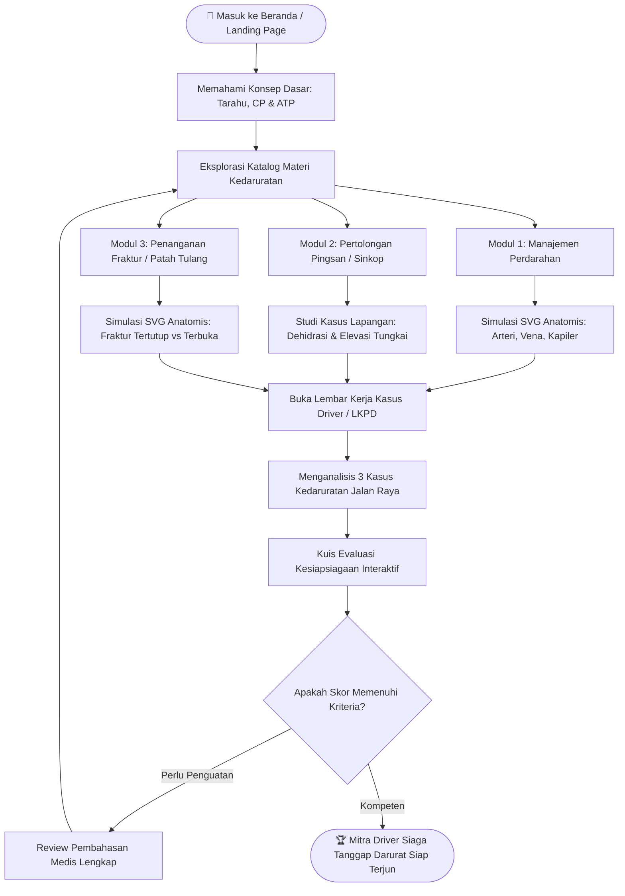
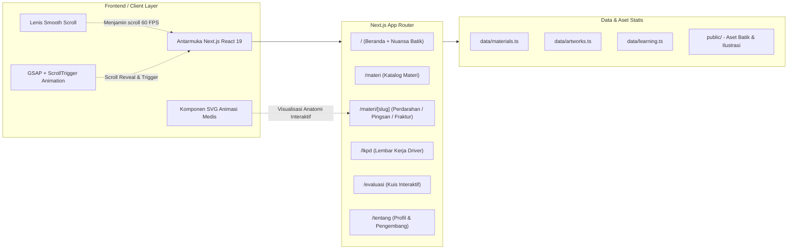

# 🚨 E-Art Gallery of Emergency

> **Platform Edukasi Seni Visual Kedaruratan Medis & Pertolongan Pertama bagi Mitra Pengemudi Ojek Online di Jalan Raya**

E-Art Gallery of Emergency adalah platform pembelajaran interaktif berbasis web yang memadukan **pendidikan medis pertolongan pertama**, **ilustrasi visual artistik/anatomis interaktif**, serta **sentuhan warisan budaya Nusantara (Batik)**. Platform ini dirancang khusus untuk meningkatkan literasi dan kesiapsiagaan tanggap darurat para mitra pengemudi ojol saat menghadapi kecelakaan lalu lintas atau insiden medis di jalan raya.

---

## 📌 Daftar Isi

1. [Alur Perjalanan Pengguna (User Learning Flow)](#1-alur-perjalanan-pengguna-user-learning-flow)
2. [Alur Tindakan Kedaruratan di Lapangan (Prinsip 3A)](#2-alur-tindakan-kedaruratan-di-lapangan-prinsip-3a)
3. [Arsitektur Aplikasi & Rute Sistem](#3-arsitektur-aplikasi--rute-sistem)
4. [Fitur Unggulan Platform](#4-fitur-unggulan-platform)
5. [Struktur Direktori Proyek](#5-struktur-direktori-proyek)
6. [Teknologi yang Digunakan (Tech Stack)](#6-teknologi-yang-digunakan-tech-stack)
7. [Panduan Instalasi & Menjalankan Aplikasi](#7-panduan-instalasi--menjalankan-aplikasi)

---

## 1. Alur Perjalanan Pengguna (User Learning Flow)

Pengguna (mitra pengemudi/siswa pelatihan) mengikuti 5 fase pembelajaran terstruktur dari pemahaman awal hingga evaluasi kesiapsiagaan:



---

## 2. Alur Tindakan Kedaruratan di Lapangan (Prinsip 3A)

Standar Operasional Prosedur (SOP) medis yang diajarkan pada platform ini mengikuti pedoman BHD dan pertolongan pertama jalan raya:


---

## 3. Arsitektur Aplikasi & Rute Sistem

Aplikasi dibangun menggunakan arsitektur modern Next.js App Router dengan pre-rendering statis dan interaktivitas komponen klien:



---

## 4. Fitur Unggulan Platform

### 🩸 1. Ilustrasi Anatomi Pembuluh Darah Interaktif (Arteri, Vena, Kapiler)

- File: `components/illustrations/BloodVesselIllustration.tsx`
- Menggantikan gambar statis dengan visual vektor anatomi beranimasi:
  - **Arteri**: Dinding tebal berotot, darah merah cerah menyembur berpulsa seirama denyut jantung (Kondisi Kritis).
  - **Vena**: Dinding lebih tipis berkatup, darah merah gelap mengalir konstan dan stabil (Bahaya Tinggi).
  - **Kapiler**: Jaringan mikroskopis 1 sel tebal, darah merembes perlahan di permukaan kulit (Ringan).

### 🦴 2. Ilustrasi Fraktur Komparatif (Fraktur Tertutup vs Terbuka)

- File: `components/illustrations/FractureIllustration.tsx`
- Menampilkan perbedaan patofisiologi cidera tulang:
  - **Fraktur Tertutup**: Kulit tetap utuh, disertai hematoma internal dan pembengkakan jaringan lunak.
  - **Fraktur Terbuka**: Robekan kulit aktif dengan fragmen ujung tulang mencuat keluar, disertai peringatan keras larangan meluruskan tulang di lapangan.

### 📝 3. LKPD Interaktif Driver Ojol

- File: `app/lkpd/page.tsx`
- Lembar studi kasus lapangan nyata yang mencakup skenario tabrakan, pingsan akibat terik matahari dan kelelahan, serta luka fraktur akibat terserempet.

### ⏱️ 4. Evaluasi Kesiapsiagaan Real-Time

- File: `app/evaluasi/page.tsx`
- Kuis interaktif dengan skor dinamis, batas waktu pengerjaan, dan pembahasan tinjauan medis langsung setelah selesai.

### 🎨 5. Sentuhan Budaya Nusantara (Batik Heritage)

- Mengintegrasikan motif kain batik klasik pada latar belakang kanvas aplikasi secara halus dan elegan, mencerminkan nilai luhur **gotong royong** bangsa Indonesia.

---

## 5. Struktur Direktori Proyek

```text
emergency-uhuy/
├── app/
│   ├── evaluasi/page.tsx          # Halaman kuis kesiapsiagaan
│   ├── lkpd/page.tsx              # Halaman LKPD studi kasus driver
│   ├── materi/
│   │   ├── page.tsx               # Katalog materi kedaruratan
│   │   └── [slug]/page.tsx        # Halaman detail materi interaktif
│   ├── tentang/page.tsx           # Halaman informasi platform & tim
│   ├── globals.css                # Konfigurasi Tailwind CSS & gaya tema
│   ├── layout.tsx                 # Root layout & optimasi font
│   └── page.tsx                   # Beranda landing page utama
├── components/
│   ├── animations/
│   │   ├── ScrollReveal.tsx       # Animasi GSAP ScrollTrigger
│   │   └── SmoothScroll.tsx       # Integrasi Lenis Smooth Scroll
│   ├── illustrations/
│   │   ├── BleedingTypesIllustration.tsx
│   │   ├── BloodVesselIllustration.tsx  # SVG animasi Arteri, Vena, Kapiler
│   │   ├── FractureIllustration.tsx     # SVG animasi Fraktur Tertutup & Terbuka
│   │   ├── FractureTypesIllustration.tsx
│   │   └── MedicalIllustration.tsx
│   ├── layout/
│   │   ├── Navbar.tsx             # Navigasi sticky responsive
│   │   └── Footer.tsx             # Footer informasi & kontak darurat
│   ├── sections/                  # Komponen seksi landing page
│   └── ui/
│       ├── BatikOrnament.tsx      # Ornamen orisinal batik nusantara
│       └── SectionHeading.tsx     # Komponen judul seksi
├── data/
│   ├── artworks.ts                # Data kartu galeri & kategori
│   ├── learning.ts                # Data CP, ATP, dan tahapan belajar
│   └── materials.ts               # Data modul medis & panduan 3A
├── public/                        # Aset gambar & ilustrasi SVG
├── next.config.ts                 # Konfigurasi Next.js & optimasi gambar
└── package.json                   # Dependensi & skrip proyek
```

---

## 6. Teknologi yang Digunakan (Tech Stack)

| Kategori          | Teknologi                  | Deskripsi                                                    |
| ----------------- | -------------------------- | ------------------------------------------------------------ |
| **Framework**     | Next.js 16 (App Router)    | Server-side rendering, static pre-rendering, & optimasi rute |
| **Bahasa**        | TypeScript                 | Type safety untuk seluruh data medis dan komponen UI         |
| **Styling**       | Tailwind CSS v4            | Utility-first styling & tema warna kedaruratan               |
| **Animasi Halus** | Lenis Scroll               | Pengalaman scroll mulus 60 FPS tanpa jank                    |
| **Motion**        | GSAP 3 & @gsap/react       | ScrollTrigger dan transisi elemen interaktif                 |
| **Ikonografi**    | Lucide React               | Ikon modern dan informatif untuk navigasi                    |
| **Font**          | Plus Jakarta Sans & Caveat | Tipografi modern yang mudah dibaca dengan aksen tulis tangan |

---

## 7. Panduan Instalasi & Menjalankan Aplikasi

Pastikan Anda telah menginstal **Node.js (v18.18+ atau v20+)** dan npm di komputer Anda.

### 1. Kloning Repository / Masuk ke Direktori

```bash
cd emergency-uhuy
```

### 2. Instalasi Dependensi

```bash
npm install
```

### 3. Menjalankan Mode Development

```bash
npm run dev
```

Buka browser dan akses [http://localhost:3000](http://localhost:3000).

### 4. Menjalankan Build Produksi

```bash
npm run build
npm run start
```

---

<div align="center">
  <sub>Dikembangkan dengan kepedulian untuk keselamatan para pejuang aspal di jalan raya.</sub><br>
  <strong>Layanan Darurat Nasional Bebas Pulsa: 112 / 119</strong>
</div>
