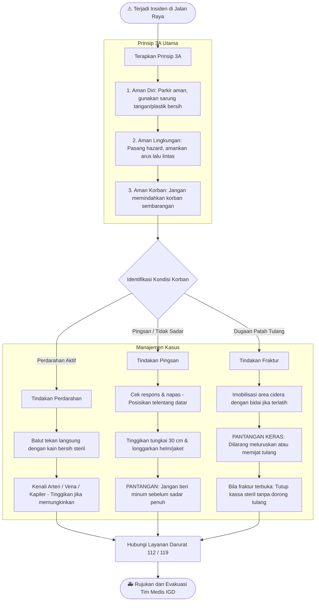
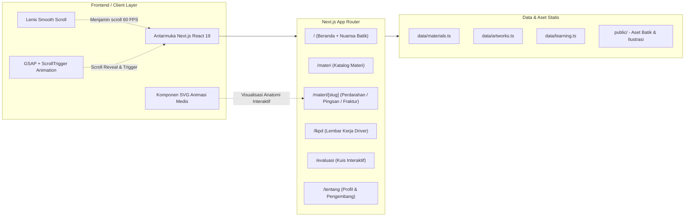

# 🚨 E-Art Gallery of Emergency
> **Platform Edukasi Seni Visual Kedaruratan Medis & Pertolongan Pertama bagi Mitra Pengemudi Ojek Online di Jalan Raya**

E-Art Gallery of Emergency adalah platform pembelajaran interaktif berbasis web yang memadukan **pendidikan medis pertolongan pertama**, **ilustrasi visual artistik/anatomis interaktif**, serta **sentuhan warisan budaya Nusantara (Batik)**. Platform ini dirancang khusus untuk meningkatkan literasi dan kesiapsiagaan tanggap darurat para mitra pengemudi ojol saat menghadapi kecelakaan lalu lintas atau insiden medis di jalan raya.

---

## 📌 Daftar Isi
1. [Alur Perjalanan Pengguna (User Learning Flow)](#1-alur-perjalanan-pengguna-user-learning-flow)
2. [Alur Tindakan Kedaruratan di Lapangan (Prinsip 3A)](#2-alur-tindakan-kedaruratan-di-lapangan-prinsip-3a)
3. [Arsitektur Aplikasi & Rute Sistem](#3-arsitektur-aplikasi--rute-sistem)
4. [Fitur Unggulan Platform](#4-fitur-unggulan-platform)
5. [Struktur Direktori Proyek](#5-struktur-direktori-proyek)
6. [Teknologi yang Digunakan (Tech Stack)](#6-teknologi-yang-digunakan-tech-stack)
7. [Panduan Instalasi & Menjalankan Aplikasi](#7-panduan-instalasi--menjalankan-aplikasi)

---

## 1. Alur Perjalanan Pengguna (User Learning Flow)

Pengguna (mitra pengemudi/siswa pelatihan) mengikuti 5 fase pembelajaran terstruktur dari pemahaman awal hingga evaluasi kesiapsiagaan:

---

## 2. Alur Tindakan Kedaruratan di Lapangan (Prinsip 3A)

Standar Operasional Prosedur (SOP) medis yang diajarkan pada platform ini mengikuti pedoman BHD dan pertolongan pertama jalan raya:

---

## 3. Arsitektur Aplikasi & Rute Sistem

Aplikasi dibangun menggunakan arsitektur modern Next.js App Router dengan pre-rendering statis dan interaktivitas komponen klien:

---

